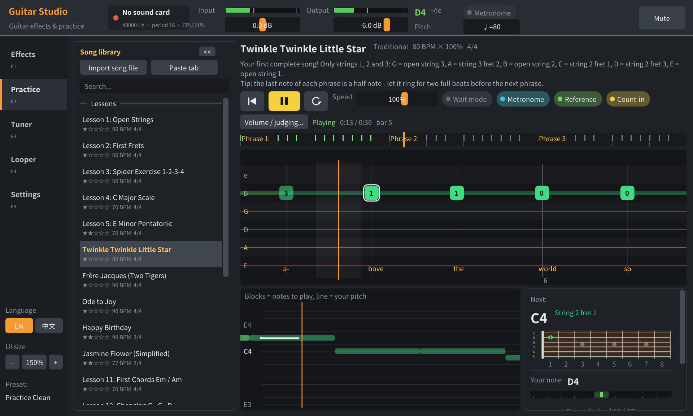
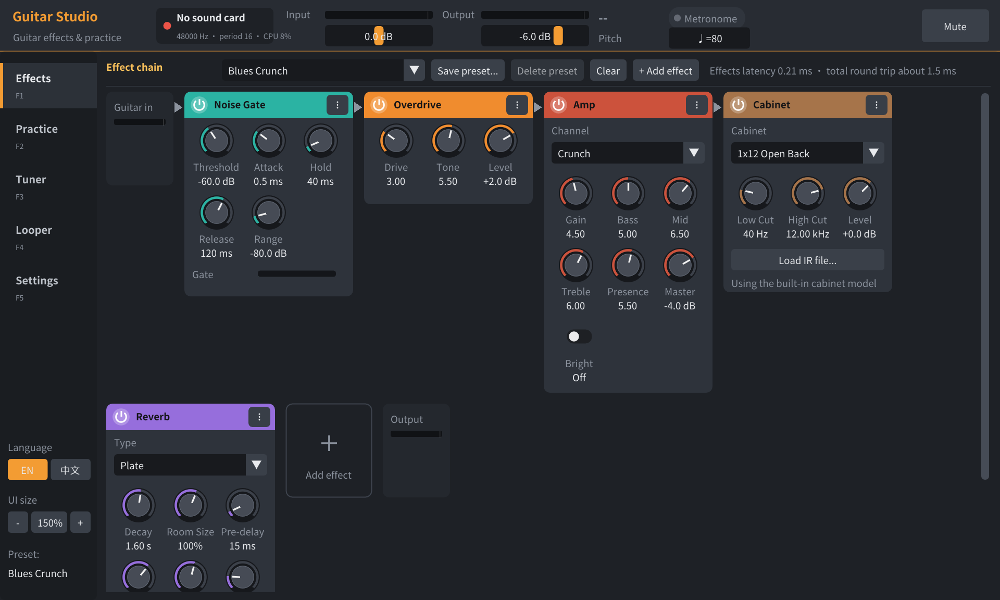

# Guitar Studio — low-latency guitar effects + practice

**English** | [中文](README.zh-CN.md)

A free, open-source guitar effects processor (dark FL Studio–style UI) and practice app for Linux:

- **Effects**: the guitar goes into the sound card's 3.5 mm input, through an effect chain, and out of the speakers. On this PC
  (Realtek ALCS1200A on-board audio) the **round-trip latency is about 3.7–4 ms** by default (0 dropouts in long tests);
  with the safety margin at 0.5 ms it gets down to 3.3 ms.
- **Practice**: 19 built-in beginner lessons, plus import of tabs from the internet (Guitar Pro / MusicXML / MIDI / text tabs).
  Notes scroll towards you like in a rhythm game while the app listens to your **pitch** and **timing** in real time and tells
  you what was right, what was wrong, and whether you were early or late.
- Tuner, metronome, looper, and system audio passthrough (practice along with a video).
- The UI is available in **English and Chinese** (English by default; switch with the "EN / 中文" buttons in the bottom-left
  corner or Settings → Interface → Language). The default UI size is 150%.



---

## 1. Connecting the guitar

```
guitar ── 6.35 mm guitar cable ── 6.35→3.5 mm adapter ── blue "line in" jack on the back of the PC (recommended)
                                                      or pink "mic" jack / front-panel mic jack
speakers / headphones ── green output (or the front-panel headphone jack)
```

- The app uses jack detection to **pick the input you plugged into automatically**.
- **Don't use the front-panel headphone jack** (it is an output). Many cases only have a single "headphone/mic combo" jack on
  the front: a normal guitar plug only touches the headphone contacts there, so the computer cannot record it, and the system
  thinks headphones were plugged in and mutes the speakers on the back. Settings → Output to can pin the output to the speakers.
- The blue line input has a higher impedance and no mic bias voltage, so it sounds better than the mic jack.
- A computer sound card has a much lower input impedance than a guitar pickup wants (≈1 MΩ), so the tone is a bit darker and
  the signal smaller. That's normal. For better sound later, get an inexpensive USB guitar interface (with a Hi-Z instrument
  input) and select it under Settings → Sound card.

## 2. Building and running

Dependencies (already installed on this PC):

```bash
sudo apt install build-essential cmake git libasound2-dev libpulse-dev libdbus-1-dev libsdl2-dev libgl-dev zlib1g-dev
```

```bash
./run.sh                       # first run downloads Dear ImGui and builds, then starts the app
./run.sh my_song.gp5           # import a song and start practicing right away
./scripts/install_desktop.sh   # optional: add a "Guitar Studio" launcher to the application menu
```

Manual build: `scripts/fetch_deps.sh && cmake -S . -B build && cmake --build build -j` → `build/guitarstudio`

Command-line options: `--simulate` (no-sound-card mode), `--demo` (a simulated player plays the song), `--device hw:X,Y`,
`--tab 0..4`, `--play`, `--preset NAME`, `--lang en|zh` (UI language), `--scale 1.5` (UI size).
Run `build/guitarstudio --help` for the full list.

## 3. Three steps for beginners

1. **Set the level**: Settings → "Auto-set gain (play for 6 s)", then play for 6 seconds at your normal strength (single
   notes + strums).
2. **Tune**: on the Tuner page, pluck the open strings one at a time starting with string 6. The needle turns green in the
   middle when the string is in tune. Click the boxes below to hear the reference pitches.
3. **Practice**: on the Practice page pick "Lesson 1: Open Strings" on the left and press **Space**. After one bar of count-in,
   play the string and fret shown when a note reaches the **orange line**.

> Start with the **speed** at 50–70%, or turn on **wait mode** (the song only continues when you play the right note).

## 4. Practice features

| Area | Description |
|---|---|
| Tab highway | 6 lines = 6 strings (the thinnest, string 1, on top); the number in a block is the fret, colors tell the strings apart. Played notes turn green (right) / orange (wrong pitch, shows what you played) / gray (missed); the number above shows the timing (+late / −early, in ms) |
| Pitch view | Blocks = notes in the song, white line = your pitch detected in real time, so you can see intonation and timing at a glance |
| Next | Where the next note is on the fretboard; chords show a chord diagram |
| Score | Perfect (≤45 ms) / Good (≤100 ms) / OK / wrong note / missed; combo; whether you are generally early or late |
| Summary | Stars at the end of a song, plus tips based on what went wrong (e.g. "you tend to play late, follow the metronome…") |

- **Speed** 25–150% (↑↓). **A-B loop**: Shift+drag on the overview bar to select a section (L toggles it); every pass is scored.
- **Wait mode** (W): stops at each note until you play it right, and plays it for you first.
- **Metronome** (M), **reference** (R, a synthesized guitar plays the song), **count-in**, and adjustable judging tolerance.
- Chords are recognized by pitch class (chroma); single notes use McLeod pitch detection plus a comparison of harmonic salience
  before and after the onset, so judging still works while other strings keep ringing.

### Importing songs

- **Drop a file onto the window** / Practice page "Import song file" (Ctrl+O) / command-line argument. Practice starts
  automatically after importing (can be turned off in Settings).
- Supported: Guitar Pro `.gp3 .gp4 .gp5 .gpx .gp`, MusicXML `.xml .musicxml .mxl`, MIDI `.mid`, text tabs `.txt .tab`, and this
  app's `.gtab`.
- Copy a text tab from a web page (the `e|---0---3---|` kind) and click "Paste tab" (Ctrl+V) to practice it.
- For files with several tracks, switch the track next to the title. Imported songs are stored in
  `~/.local/share/guitarstudio/songs/`.

### Writing your own songs (.gtab)

Plain text; see `assets/songs/` for examples. The full format is documented at the top of `src/song/Song.h`.
Title, description, section names and lyrics can be written as `English|中文`; the UI shows the side for the current language.

```
title: Twinkle Twinkle Little Star|小星星
bpm: 80
time: 4/4
3.0 3.0 2.3 2.3 | 1.0 1.0 2.3/2 |       # string.fret, /2 = half note (quarter by default)
[G]/2 [C]/2 | [D]v [G]^ r/2 |           # named chords, v ^ strum direction, r rest
E4/8 F#4 G4 A4                          # note names work too; the fretboard position is chosen automatically
```

## 5. Effects

18 effects and 10 presets (the first one, "Practice Clean", is the default):



Noise Gate · Compressor · Boost · Overdrive (TS) · Distortion (RAT) · Fuzz · Amp (clean / crunch / high gain / metal, with a
real tone stack) · Cabinet (5 built-in models + WAV impulse responses) · 7-band EQ · Wah (manual / auto / LFO) · Chorus ·
Flanger · Phaser · Tremolo · Delay (digital / analog / ping-pong, tempo sync) · Reverb (room / hall / plate) · Octaver · Volume

- Knobs: drag up/down (Shift for fine control), mouse wheel, double-click to reset. Drag a card title to reorder; the power
  button bypasses an effect (click-free crossfade).
- All distortion effects run 4× oversampled (low-latency IIR half-band filters); a full effect chain uses about 2% of one core.
- Presets are stored in `~/.config/guitarstudio/presets/`; the current chain is saved automatically on exit.

## 6. How the low latency works

- **Direct ALSA hardware access** (`hw:PCH,0`), with the capture and playback streams linked to start together, processing
  every 16 frames (0.33 ms).
- The standard **device reservation protocol** (same as JACK) asks PulseAudio to release the sound card temporarily; it gets the
  card back automatically on exit.
- The audio thread gets real-time priority through **rtkit** (no root needed); memory is locked; denormals are disabled.
- **Auto-calibration**: the on-board HDA codec prefetches about 48 frames into its FIFO at start-up, and capture-period readiness
  jitters. At startup the app runs silence for half a second to measure the smallest buffer this card really needs (about
  85–110 frames) and adds a safety margin; if a dropout still happens, it adds another 0.25 ms automatically. Measured
  (16-frame period, with the UI and an effect chain running):

| Safety margin | Round trip | Dropouts in 45 s |
|---|---|---|
| 0.5 ms | 3.3 ms | 1–2 (then grows automatically) |
| **1.0 ms (default)** | **3.7–4.0 ms** | **0** |
| 64-frame period | 6.0 ms | 0 |

For even lower and steadier latency, run `scripts/setup_realtime.sh` (sets up real-time priority and lets the app keep the CPU
out of deep sleep; needs sudo and a new login). After that you can lower the safety margin to 0.5 ms; adding
`preempt=full threadirqs` to the kernel boot parameters helps further.

## 7. System audio passthrough

While this app owns the sound card, audio from browsers and other programs would normally be paused. With "System audio
passthrough" on (the default), the app creates a virtual output `GuitarStudio-SystemAudio`, makes it the default and mixes its
sound in, so you can play along with a lesson video or a backing track. The original setup is restored on exit (after a crash
it is cleaned up on the next start).

## 8. Keyboard shortcuts

| Key | Action |
|---|---|
| Space | Start / pause |
| Esc / Home | Back to the start |
| ← → | Previous / next bar |
| ↑ ↓ | Speed ±5% |
| L / W / M / R | Loop / wait mode / metronome / reference |
| F1–F5 | Effects / Practice / Tuner / Looper / Settings |
| Ctrl+O / Ctrl+V | Import song / paste tab |
| Ctrl + / Ctrl − / Ctrl 0 / Ctrl+wheel | Zoom the UI in / out / back to the default 150% (also − / + buttons in the bottom-left corner; Settings → Interface has 100–200% presets) |

## 9. Troubleshooting

- **No sound**: check that the "Output" meter in the top bar moves; that the top-right button doesn't say "Muted"; that Settings →
  Output to is set to "Speakers"; the sound card master volume in Settings; and that the speakers are in the green jack.
- **The system output switches to "headphones" and the speakers go silent as soon as the guitar is plugged into the front
  panel**: the guitar is in the front headphone (or combo) jack. Plug it into the blue line-in jack on the back instead.
- **No input**: check under Settings → Input that the jack shows "(plugged in)"; turn up the guitar's volume knob; use
  "Auto-set gain".
- **Red frame around the input meter**: the input is clipping; lower the hardware gain (or run auto gain again).
- **Feedback / suddenly very loud**: click "Mute" in the top-right corner. With high-gain tones the guitar squeals when it is too
  close to the speakers; turn on the noise gate or lower the volume.
- **Many dropouts (xruns)**: increase the "Safety margin" or the "Period" in Settings and click "Apply and restart audio".
- **Sound card busy**: close other programs that use the card directly (such as JACK), or choose another device in Settings.
  If the card cannot be opened, the app runs in no-sound-card mode.
- **Judged late/early although you feel on time**: Settings → Practice → Latency calibration.

## 10. Development

```
src/audio/     ALSA full duplex + auto-calibration, device reservation (D-Bus), rtkit, card mixer, PulseAudio passthrough, engine, looper
src/dsp/ fx/   DSP building blocks (biquads / oversampling / delay lines / tone stack / WAV) and the 18 effects, presets
src/analysis/  pitch (McLeod), onsets (log spectral flux), chroma, harmonic salience
src/practice/  transport (sample-accurate, wait mode / loop / speed), scorer, plucked-string synth (reference), metronome
src/song/      song model and import (gtab / ASCII / MusicXML / MIDI / Guitar Pro 3-7), automatic fingering, chord library
src/ui/        Dear ImGui user interface
src/common/    shared helpers, including i18n: source strings are English, each module's I18nZh.cpp holds the Chinese catalog
tests/         offline tests (no sound card needed): test_fx test_song test_analysis test_practice; test_engine uses the real card
```

`cmake --build build -j && build/test_practice` runs the whole practice flow with a synthesized "simulated player" (timing
errors / wrong notes / missed notes / chords / wait mode / loops).

### Translations

All text in the source code is English. User-facing strings go through `tr()` (see `src/common/I18n.h`), and each module
registers its Chinese catalog at startup (`src/*/I18nZh.cpp`). Song data uses `English|中文` and is resolved with `loc()`.
All catalogs share one table keyed by the English text, so one English string must always have the same Chinese translation;
conflicts are reported on stderr at startup.

License: MIT. Third party: [Dear ImGui](https://github.com/ocornut/imgui) (MIT). The built-in songs are public-domain
traditional melodies or original exercises.
