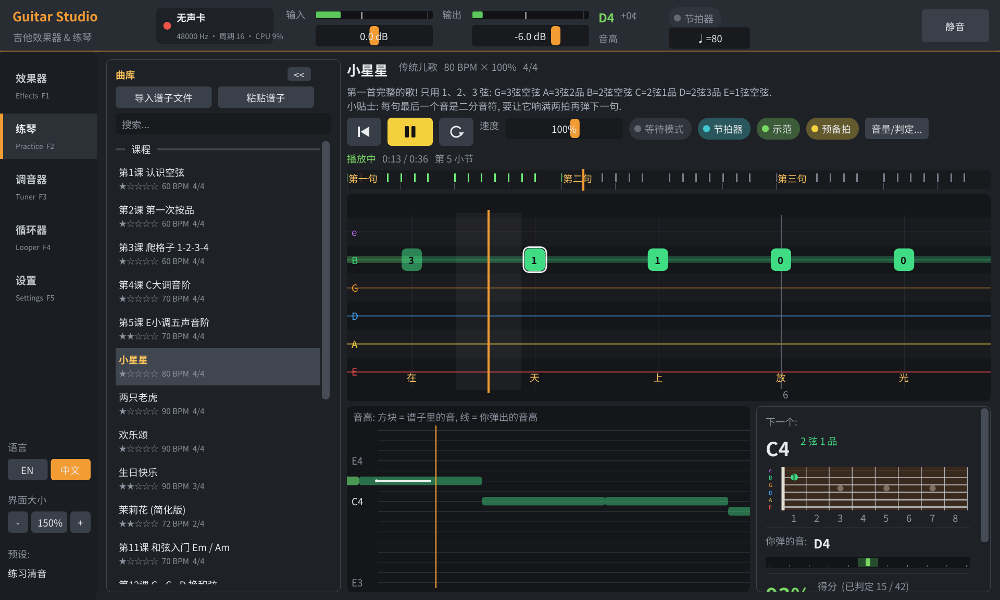
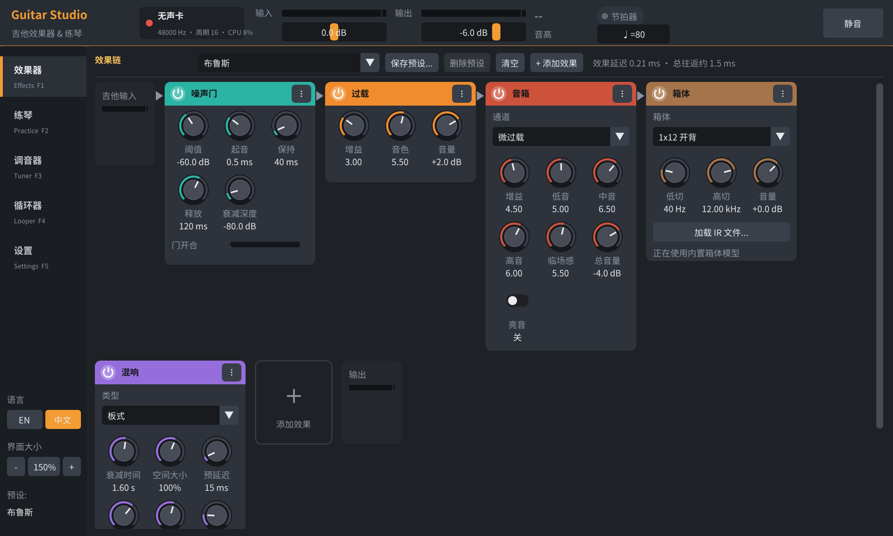

# Guitar Studio — 低延迟吉他效果器 + 练琴

[English](README.md) | **中文**

开源、免费的 Linux 吉他效果器 (类似 FL Studio 的深色界面) 和练琴软件:

- **效果器**: 吉他从声卡 3.5mm 输入, 经过效果链从音箱输出. 在这台电脑 (Realtek ALCS1200A 板载声卡) 上
  **往返延迟约 3.7~4 ms** (默认, 长时间测试 0 爆音); 安全余量调到 0.5 ms 可以到 3.3 ms.
- **练琴**: 内置 19 课新手课程, 也能导入网上的谱子 (Guitar Pro / MusicXML / MIDI / 文字六线谱).
  音符像音乐游戏一样滚动过来, 软件实时听你弹的 **音高** 和 **节奏**, 告诉你哪里对、哪里错、偏早还是偏晚.
- 调音器、节拍器、循环录音器 (Looper)、系统声音直通 (边看教学视频边练).
- 界面支持 **中文 / English** (默认英文; 左下角 "EN / 中文" 按钮或 设置 → 界面 → 语言 切换), 界面大小默认 150%.



---

## 1. 接线

```
吉他 ── 6.35mm 吉他线 ── 6.35→3.5mm 转接头 ── 机箱后面 蓝色 "线路输入" (推荐)
                                            或 粉色 "麦克风" / 前面板麦克风孔
音箱 / 耳机 ── 绿色输出 (或前面板耳机孔)
```

- 软件会通过插孔检测 **自动选择** 你插的那个输入孔.
- **不要插前面板的耳机孔** (那是输出). 很多机箱前面板只有一个 "耳机/麦克风二合一" 孔, 普通吉他插头插进去碰到的是耳机触点,
  电脑录不到声音, 而且系统会以为插了耳机, 把后面的音箱静音. 软件的 设置 → 输出到 可以固定输出到音箱.
- 线路输入 (蓝色) 阻抗更高、没有麦克风偏置电压, 音色比麦克风孔好.
- 电脑声卡的输入阻抗比吉他拾音器需要的 (≈1 MΩ) 低很多, 声音会偏暗、信号偏小, 这是正常的.
  以后想要更好的音质, 买一个便宜的 USB 吉他声卡 (带 Hi-Z 乐器输入), 在 设置 → 声卡 里选它即可.

## 2. 编译与运行

依赖 (这台电脑上都已经装好):

```bash
sudo apt install build-essential cmake git libasound2-dev libpulse-dev libdbus-1-dev libsdl2-dev libgl-dev zlib1g-dev
```

```bash
./run.sh                       # 第一次会自动下载 Dear ImGui 并编译, 然后启动
./run.sh 我的谱子.gp5           # 直接导入一个谱子并开始练习
./scripts/install_desktop.sh   # 可选: 在应用菜单里添加 "Guitar Studio" 图标
```

手动编译: `scripts/fetch_deps.sh && cmake -S . -B build && cmake --build build -j` → `build/guitarstudio`

命令行选项: `--simulate` (无声卡模式), `--demo` (演示: 模拟一个玩家自动弹), `--device hw:X,Y`,
`--tab 0..4`, `--play`, `--preset 名称`, `--lang en|zh` (界面语言), `--scale 1.5` (界面大小). 运行 `build/guitarstudio --help` 查看全部.

## 3. 新手三步

1. **调电平**: 设置 → "自动设置增益 (弹 6 秒)", 用平时的力度弹 6 秒 (单音 + 扫弦).
2. **调音**: 调音器页, 从 6弦开始一根一根拨空弦, 指针在中间变绿就准了. 点下面的方块能听标准音.
3. **练琴**: 练琴页左边选 "第1课 认识空弦" (Lesson 1: Open Strings), 按 **空格** 开始. 先有一小节预备拍, 音符到达 **橙色竖线** 时弹对应的弦和品.

> 刚开始把 **速度** 调到 50%~70%, 或者打开 **等待模式** (弹对了才继续), 不着急.

## 4. 练琴功能

| 区域 | 说明 |
|---|---|
| 六线谱瀑布 | 6 条线 = 6 根弦 (上面是最细的 1弦), 方块里的数字 = 品位, 颜色区分弦. 弹完后变绿 (对) / 橙 (音不对, 会显示你弹成了什么) / 灰 (漏了), 上方数字是快慢 (+晚 / −早, 毫秒) |
| 音高对比 | 色块 = 谱子上的音, 白线 = 实时检测到的你的音高. 能直观看出音准和时机 |
| 下一个 | 下一个要弹的音在指板上的位置, 和弦会显示和弦图 |
| 得分 | 完美 (≤45 ms) / 很好 (≤100 ms) / 还行 / 音错 / 漏; 连击; 整体偏早还是偏晚 |
| 总结 | 一首弹完会打星, 并根据你的问题给出建议 (比如 "整体偏晚, 跟着节拍器…") |

- **速度** 25%~150% (↑↓), **循环 A-B**: 在进度条上按住 Shift 拖动选一段 (L 开关), 每一遍的得分都会记录下来.
- **等待模式** (W): 走到每个音时停下来等你弹对, 并先用示范音弹给你听.
- **节拍器** (M)、**示范音** (R, 合成吉他声弹谱子)、**预备拍**、判定宽松度可调.
- 和弦用 "音级 (chroma)" 识别, 单音用 McLeod 音高检测 + 起音前后的谐波显著度比较 —— 其他弦还在响也能判断对错.

### 导入谱子

- **拖进窗口** / 练琴页 "导入谱子文件" (Ctrl+O) / 命令行参数. 导入后自动开始练习 (可在设置里关闭).
- 支持: Guitar Pro `.gp3 .gp4 .gp5 .gpx .gp`, MusicXML `.xml .musicxml .mxl`, MIDI `.mid`, 文字六线谱 `.txt .tab`, 本软件的 `.gtab`.
- 在网页上复制一段文字六线谱 (`e|---0---3---|` 那种), 点 "粘贴谱子" (Ctrl+V) 就能练.
- 多音轨的文件可以在标题旁边切换音轨. 导入的谱子保存在 `~/.local/share/guitarstudio/songs/`.

### 自己写谱子 (.gtab)

纯文本, 例子见 `assets/songs/`. 完整格式说明在 `src/song/Song.h` 开头.
标题、说明、段落名和歌词可以写成 `English|中文`, 界面按当前语言显示其中一边.

```
title: Twinkle Twinkle Little Star|小星星
bpm: 80
time: 4/4
3.0 3.0 2.3 2.3 | 1.0 1.0 2.3/2 |       # 弦.品, /2 = 二分音符 (默认四分)
[G]/2 [C]/2 | [D]v [G]^ r/2 |           # 命名和弦, v ^ 扫弦方向, r 休止
E4/8 F#4 G4 A4                          # 也可以直接写音名, 自动选把位
```

## 5. 效果器

18 种效果器, 10 个预设 (第一个 "练习清音" 是默认):



噪声门 · 压缩 · 提升 · 过载 (TS) · 失真 (RAT) · 法兹 · 音箱 (清音/微过载/高增益/金属, 真实音色堆栈) · 箱体
(5 种内置 + 可加载 WAV 格式的 IR) · 7 段均衡 · 哇音 (手动/自动/LFO) · 合唱 · 镶边 · 移相 · 颤音 · 延迟 (数字/模拟/乒乓,
可同步节拍) · 混响 (房间/大厅/板式) · 八度 · 音量

- 旋钮: 上下拖动 (Shift 微调)、滚轮、双击恢复默认. 拖动卡片标题改变顺序, 电源键旁通 (无爆音交叉淡化).
- 失真类全部 4 倍过采样 (低延迟 IIR 半带滤波器), 一整条效果链 CPU 占用约 2% 单核.
- 预设保存在 `~/.config/guitarstudio/presets/`, 退出时自动保存当前效果链.

## 6. 低延迟是怎么做到的

- **ALSA 直连硬件** (`hw:PCH,0`), 录音和放音流链接同步启动, 每 16 帧 (0.33 ms) 处理一次.
- 通过标准 **设备预留协议** (和 JACK 一样) 请 PulseAudio 暂时让出声卡, 退出后自动还回去.
- 音频线程通过 **rtkit** 获得实时优先级 (不需要 root); 内存锁定; 关闭非规格化浮点.
- **自动校准**: 板载 HDA 声卡启动时 FIFO 会预取约 48 帧, 录音周期就绪时间也有抖动. 程序启动时用静音跑半秒,
  测出这块声卡实际需要的最小缓冲 (约 85~110 帧), 再加安全余量; 真出现爆音会自动再加 0.25 ms. 实测 (周期 16 帧, 带界面和效果链):

| 安全余量 | 往返延迟 | 45 秒内爆音 |
|---|---|---|
| 0.5 ms | 3.3 ms | 1~2 次 (之后自动加大) |
| **1.0 ms (默认)** | **3.7~4.0 ms** | **0** |
| 周期 64 帧 | 6.0 ms | 0 |

想更低更稳: `scripts/setup_realtime.sh` (配置实时优先级 + 允许阻止 CPU 深度睡眠, 需要 sudo, 重新登录生效), 之后可以把安全余量调到
0.5 ms; 内核启动参数加 `preempt=full threadirqs` 效果更好.

## 7. 系统声音直通

本软件独占声卡时, 浏览器等程序的声音本来会被暂停. 开启 "系统声音直通" (默认开) 后, 软件会创建一个虚拟输出
`GuitarStudio-SystemAudio` 并设为默认, 把它的声音混进来 —— 可以一边放 B 站教学视频/伴奏一边弹. 退出时自动恢复原来的设置
(异常退出的话, 下次启动会自动清理).

## 8. 快捷键

| 键 | 功能 |
|---|---|
| 空格 | 开始 / 暂停 |
| Esc / Home | 回到开头 |
| ← → | 上一小节 / 下一小节 |
| ↑ ↓ | 速度 ±5% |
| L / W / M / R | 循环 / 等待模式 / 节拍器 / 示范音 |
| F1~F5 | 效果器 / 练琴 / 调音器 / 循环器 / 设置 |
| Ctrl+O / Ctrl+V | 导入谱子 / 粘贴谱子 |
| Ctrl + / Ctrl − / Ctrl 0 / Ctrl+滚轮 | 界面放大 / 缩小 / 恢复默认 150% (左下角也有 − / + 按钮, 设置 → 界面 有 100%~200% 预设) |

## 9. 常见问题

- **没有声音**: 看顶栏 "输出" 电平表有没有跳; 右上角是不是 "已静音"; 设置 → 输出到 选 "音箱"; 设置 → 声卡硬件主音量; 音箱接在绿色孔.
- **前面板一插吉他, 系统输出就变成 "耳机", 音箱没声音**: 吉他插到了前面板耳机孔 (或二合一孔). 改插机箱后面蓝色线路输入孔.
- **输入没反应**: 设置 → 输入 里看插孔是否显示 "已插入"; 吉他音量旋钮开大; 用 "自动设置增益".
- **输入电平表红框**: 削波了, 调低硬件增益 (或重新自动设置增益).
- **啸叫 / 突然很响**: 点右上角 "静音". 高增益音色下吉他离音箱太近会啸叫, 打开噪声门或调小音量.
- **爆音 (xrun) 多**: 设置里增大 "安全余量" 或 "周期", 点 "应用并重启音频".
- **声卡被占用**: 关掉其他直接占用声卡的程序 (如 JACK), 或在设置里换设备. 打不开声卡时软件会进入无声卡模式.
- **判定总说偏晚/偏早但我觉得准**: 设置 → 练琴 → 延迟校准.

## 10. 开发

```
src/audio/     ALSA 全双工 + 自动校准, 设备预留 (D-Bus), rtkit, 声卡混音器, PulseAudio 直通, 引擎, 循环器
src/dsp/ fx/   DSP 基础 (双二阶/过采样/延迟线/音色堆栈/WAV) 与 18 种效果器, 预设
src/analysis/  音高 (McLeod)、起音 (对数谱通量)、音级、谐波显著度
src/practice/  走带 (采样级精确, 等待模式/循环/变速), 评分器, 拨弦合成器 (示范音), 节拍器
src/song/      谱子模型与导入 (gtab / ASCII / MusicXML / MIDI / Guitar Pro 3-7), 自动把位, 和弦库
src/ui/        Dear ImGui 界面
src/common/    中英文界面 (i18n): 源码里是英文, 各模块的 I18nZh.cpp 是中文翻译表
tests/         离线测试 (不需要声卡): test_fx test_song test_analysis test_practice; test_engine 用真实声卡
```

`cmake --build build -j && build/test_practice` —— 用合成的 "模拟玩家" 走完整个练琴流程 (节奏误差/错音/漏音/和弦/等待模式/循环).

许可: MIT. 第三方: [Dear ImGui](https://github.com/ocornut/imgui) (MIT). 内置曲目均为公有领域的传统旋律或原创练习.
